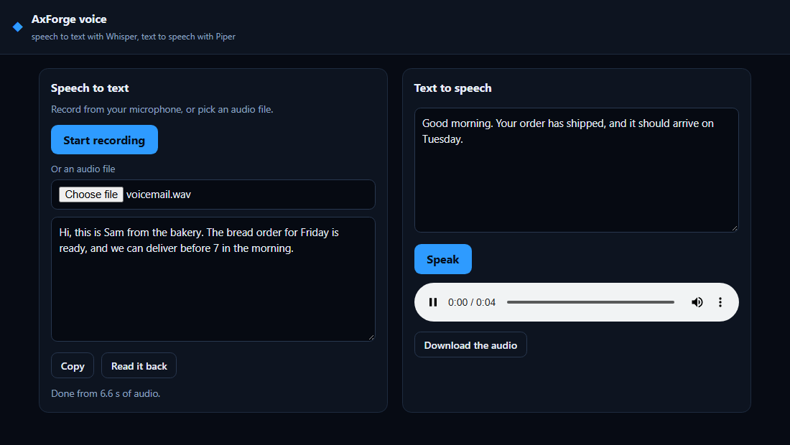

# AxForge voice

Speech to text and text to speech, on the [AxForge](https://axforge.ai) API. Record from your microphone or pick an
audio file and get the words back, or type text and hear it spoken. Plain HTML and JavaScript, plus a small Node.js
server that keeps your API key. No dependencies and no build step.



## What it uses

| Model | API model name | Endpoint | What for |
|---|---|---|---|
| Whisper | `whisper` | `POST /v1/audio/transcriptions` | Speech to text, from a recording or an audio file |
| Piper | `piper` | `POST /v1/audio/speech` | Text to speech, answered as a WAV file |

See the [audio docs](https://dev.axforge.ai/docs/audio/).

## Run it, step by step

1. **Node.js 22 or newer.** Check with `node --version`. Get it from [nodejs.org](https://nodejs.org).
2. **Get the code.** Clone this repository, or download it as a ZIP and unpack it. Then open a terminal in the
   folder.
3. **Get an API key.** Sign in at [console.axforge.ai](https://console.axforge.ai/keys) and make a key.
4. **Put the key in `.env`.** Copy the example file:
   - macOS and Linux: `cp .env.example .env`
   - Windows: `copy .env.example .env`

   Open `.env` and paste your key after `AXFORGE_API_KEY=`.
5. **Start it:**

   ```
   npm start
   ```

   Open http://127.0.0.1:3000. Press **Start recording**, say something, and press it again. Or press **Speak**.
   Press Ctrl+C in the terminal to stop the server.

There is nothing to install: `npm start` only runs `node server.js`.

## How it works

| File | What it does |
|---|---|
| `server.js` | Serves the page, sends recordings to Whisper as a file upload, and sends text to Piper, with your key |
| `public/index.html` | The page: recording, a file picker, the words, and the text to speak |
| `public/app.js` | Records with the browser's `MediaRecorder`, sends the audio, and plays the WAV that comes back. Start here |
| `public/style.css` | The look, safe to replace |

The two calls:

```js
// speech to text: a multipart upload with the file and the model
const form = new FormData();
form.append("file", audioBlob, "meeting.webm");
form.append("model", "whisper");
const { text } = await (await fetch("https://api.axforge.ai/v1/audio/transcriptions", {
  method: "POST",
  headers: { Authorization: `Bearer ${process.env.AXFORGE_API_KEY}` },
  body: form,
})).json();

// text to speech: JSON in, the audio itself out
const wav = await (await fetch("https://api.axforge.ai/v1/audio/speech", {
  method: "POST",
  headers: { Authorization: `Bearer ${process.env.AXFORGE_API_KEY}`, "Content-Type": "application/json" },
  body: JSON.stringify({ model: "piper", input: "Your order has shipped." }),
})).arrayBuffer();
```

## Good to know

- **The microphone:** the browser asks once. It allows the microphone on `http://127.0.0.1`. On any other address it
  needs `https`.
- **Recordings are sent as the browser makes them** (WebM with Opus in Chrome). Whisper takes them as they are, and
  WAV files too.
- **Your key stays on the server.** The page only talks to `server.js`, which listens on 127.0.0.1, so only your own
  computer can reach it. Before you put it online, add your own sign-in, so strangers cannot spend your key.
- **Nothing is stored.** Audio and text live in the page until you close it.
- **Prices:** see the [pricing page](https://axforge.ai/pricing/).

## License

MIT, see [LICENSE](LICENSE).
